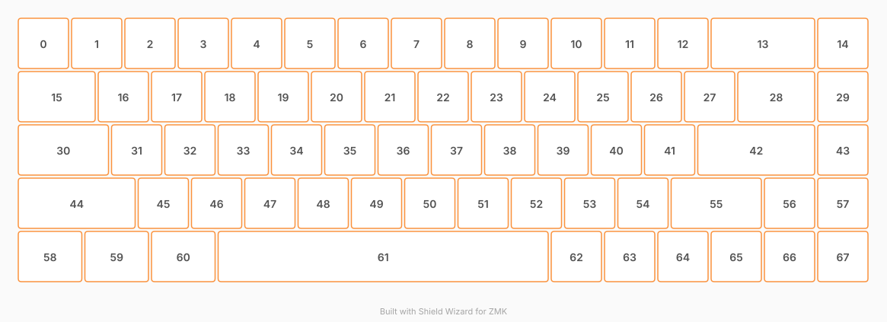

# ZMK Configuration for HandyKeysWired

*Generated by Shield Wizard for ZMK*



Download compiled firmware from the Actions tab. <https://zmk.dev/docs/user-setup#installing-the-firmware>

Edit your keymap <https://zmk.dev/docs/keymaps>.
User keymap is located at [`config/handykeyswired.keymap`](config/handykeyswired.keymap).

-----

<details>
<summary>
Shield Wizard Debug Information
</summary>

In case of broken configuration, here is the Shield Wizard internal data used to generate this configuration:

Commit: 6764e3d30a05e636ed273f525928b404e08565e9

```json
{"name":"HandyKeysWired","shield":"handykeyswired","dongle":false,"modules":[],"layout":[{"id":"01M7EFC0R3RZG4VR629HY6W466","part":0,"row":0,"col":0,"w":1,"h":1,"x":0,"y":0,"r":0,"rx":0,"ry":0},{"id":"01M7EFC0R3DT8RCXSNBDVP0H09","part":0,"row":0,"col":1,"w":1,"h":1,"x":1,"y":0,"r":0,"rx":0,"ry":0},{"id":"01M7EFC0R3BESAQQ8736N4VM92","part":0,"row":0,"col":2,"w":1,"h":1,"x":2,"y":0,"r":0,"rx":0,"ry":0},{"id":"01M7EFC0R3VGVYBK5V9Z3Y2APF","part":0,"row":0,"col":3,"w":1,"h":1,"x":3,"y":0,"r":0,"rx":0,"ry":0},{"id":"01M7EFC0R34MXWQWXB5K4G056Y","part":0,"row":0,"col":4,"w":1,"h":1,"x":4,"y":0,"r":0,"rx":0,"ry":0},{"id":"01M7EFC0R3RSGTM1PGQMZMPY5N","part":0,"row":0,"col":5,"w":1,"h":1,"x":5,"y":0,"r":0,"rx":0,"ry":0},{"id":"01M7EFC0R3823EMQ1Q768KWX72","part":0,"row":0,"col":6,"w":1,"h":1,"x":6,"y":0,"r":0,"rx":0,"ry":0},{"id":"01M7EFC0R3NS2BVAVP3M4P0BA7","part":0,"row":0,"col":7,"w":1,"h":1,"x":7,"y":0,"r":0,"rx":0,"ry":0},{"id":"01M7EFC0R37WMM14VHGY4TBT9S","part":0,"row":0,"col":8,"w":1,"h":1,"x":8,"y":0,"r":0,"rx":0,"ry":0},{"id":"01M7EFC0R3ZH6EKFB5HRR68N02","part":0,"row":0,"col":9,"w":1,"h":1,"x":9,"y":0,"r":0,"rx":0,"ry":0},{"id":"01M7EFC0R34NRD88JG0FXSYJ3A","part":0,"row":0,"col":10,"w":1,"h":1,"x":10,"y":0,"r":0,"rx":0,"ry":0},{"id":"01M7EFC0R3RBN65ZVGDP58DMHG","part":0,"row":0,"col":11,"w":1,"h":1,"x":11,"y":0,"r":0,"rx":0,"ry":0},{"id":"01M7EFC0R3KT8Q1CN8TX7GE67E","part":0,"row":0,"col":12,"w":1,"h":1,"x":12,"y":0,"r":0,"rx":0,"ry":0},{"id":"01M7EFC0R3C30XAMWE68NCVBH6","part":0,"row":0,"col":13,"w":2,"h":1,"x":13,"y":0,"r":0,"rx":0,"ry":0},{"id":"01M7EFC0R335G6GX4YGYR8YVA1","part":0,"row":0,"col":15,"w":1,"h":1,"x":15,"y":0,"r":0,"rx":0,"ry":0},{"id":"01M7EFC0R37SNY7S0ZW7JMM125","part":0,"row":1,"col":0,"w":1.5,"h":1,"x":0,"y":1,"r":0,"rx":0,"ry":0},{"id":"01M7EFC0R35TBBN9ZHAQD67DBW","part":0,"row":1,"col":1,"w":1,"h":1,"x":1.5,"y":1,"r":0,"rx":0,"ry":0},{"id":"01M7EFC0R3H8M9KM3R1ZAMX4MM","part":0,"row":1,"col":2,"w":1,"h":1,"x":2.5,"y":1,"r":0,"rx":0,"ry":0},{"id":"01M7EFC0R3F2FD0YRGWQ38KPJ9","part":0,"row":1,"col":3,"w":1,"h":1,"x":3.5,"y":1,"r":0,"rx":0,"ry":0},{"id":"01M7EFC0R3J14HP6W9QJ7AN2F7","part":0,"row":1,"col":4,"w":1,"h":1,"x":4.5,"y":1,"r":0,"rx":0,"ry":0},{"id":"01M7EFC0R3W7P68PXPJM4MRH0Q","part":0,"row":1,"col":5,"w":1,"h":1,"x":5.5,"y":1,"r":0,"rx":0,"ry":0},{"id":"01M7EFC0R36PQK35BHRB7ZVA1Z","part":0,"row":1,"col":6,"w":1,"h":1,"x":6.5,"y":1,"r":0,"rx":0,"ry":0},{"id":"01M7EFC0R3SY0998PQMGXKY8YE","part":0,"row":1,"col":7,"w":1,"h":1,"x":7.5,"y":1,"r":0,"rx":0,"ry":0},{"id":"01M7EFC0R3Q117AJWBAMXSHETJ","part":0,"row":1,"col":8,"w":1,"h":1,"x":8.5,"y":1,"r":0,"rx":0,"ry":0},{"id":"01M7EFC0R382Y9FY266QZ75BMD","part":0,"row":1,"col":9,"w":1,"h":1,"x":9.5,"y":1,"r":0,"rx":0,"ry":0},{"id":"01M7EFC0R3C1QP4HNR0GTJ9YQE","part":0,"row":1,"col":10,"w":1,"h":1,"x":10.5,"y":1,"r":0,"rx":0,"ry":0},{"id":"01M7EFC0R3HJ3XA1AEYQ59DMMN","part":0,"row":1,"col":11,"w":1,"h":1,"x":11.5,"y":1,"r":0,"rx":0,"ry":0},{"id":"01M7EFC0R384DXAT53RN8BYAA1","part":0,"row":1,"col":12,"w":1,"h":1,"x":12.5,"y":1,"r":0,"rx":0,"ry":0},{"id":"01M7EFC0R37DYCSVVB97J3Y259","part":0,"row":1,"col":13,"w":1.5,"h":1,"x":13.5,"y":1,"r":0,"rx":0,"ry":0},{"id":"01M7EFC0R35C4BHTTZVQMADPKV","part":0,"row":1,"col":14,"w":1,"h":1,"x":15,"y":1,"r":0,"rx":0,"ry":0},{"id":"01M7EFC0R3ZHK9EQY9PFZ0FR01","part":0,"row":2,"col":0,"w":1.75,"h":1,"x":0,"y":2,"r":0,"rx":0,"ry":0},{"id":"01M7EFC0R3GB9T8866V609C9AD","part":0,"row":2,"col":1,"w":1,"h":1,"x":1.75,"y":2,"r":0,"rx":0,"ry":0},{"id":"01M7EFC0R3SGY3TN4RY0HAPPDA","part":0,"row":2,"col":2,"w":1,"h":1,"x":2.75,"y":2,"r":0,"rx":0,"ry":0},{"id":"01M7EFC0R3QKE8Y3N2FRTTPQ1T","part":0,"row":2,"col":3,"w":1,"h":1,"x":3.75,"y":2,"r":0,"rx":0,"ry":0},{"id":"01M7EFC0R3QZD3FVQKTWJHR82K","part":0,"row":2,"col":4,"w":1,"h":1,"x":4.75,"y":2,"r":0,"rx":0,"ry":0},{"id":"01M7EFC0R3022F603GS0WK7YWQ","part":0,"row":2,"col":5,"w":1,"h":1,"x":5.75,"y":2,"r":0,"rx":0,"ry":0},{"id":"01M7EFC0R3KW1R1GXEBREVJEQF","part":0,"row":2,"col":6,"w":1,"h":1,"x":6.75,"y":2,"r":0,"rx":0,"ry":0},{"id":"01M7EFC0R39A6A2PB0B7228E3K","part":0,"row":2,"col":7,"w":1,"h":1,"x":7.75,"y":2,"r":0,"rx":0,"ry":0},{"id":"01M7EFC0R32X9CRKY2ZNT96SYJ","part":0,"row":2,"col":8,"w":1,"h":1,"x":8.75,"y":2,"r":0,"rx":0,"ry":0},{"id":"01M7EFC0R35TKZBWFWVJKW6F3C","part":0,"row":2,"col":9,"w":1,"h":1,"x":9.75,"y":2,"r":0,"rx":0,"ry":0},{"id":"01M7EFC0R3DRCYX7YH44ARD0MV","part":0,"row":2,"col":10,"w":1,"h":1,"x":10.75,"y":2,"r":0,"rx":0,"ry":0},{"id":"01M7EFC0R34VGDB6XTKC78AG4X","part":0,"row":2,"col":11,"w":1,"h":1,"x":11.75,"y":2,"r":0,"rx":0,"ry":0},{"id":"01M7EFC0R3QE3V1WK4YYG9CA28","part":0,"row":2,"col":12,"w":2.25,"h":1,"x":12.75,"y":2,"r":0,"rx":0,"ry":0},{"id":"01M7EFC0R3EAJ249A6G28HZ26F","part":0,"row":2,"col":13,"w":1,"h":1,"x":15,"y":2,"r":0,"rx":0,"ry":0},{"id":"01M7EFC0R3Q40RV4W7MT3E5C17","part":0,"row":3,"col":0,"w":2.25,"h":1,"x":0,"y":3,"r":0,"rx":0,"ry":0},{"id":"01M7EFC0R3RDM2RFGZYJMV7W1C","part":0,"row":3,"col":2,"w":1,"h":1,"x":2.25,"y":3,"r":0,"rx":0,"ry":0},{"id":"01M7EFC0R3THQZE47FHMT4RBJZ","part":0,"row":3,"col":3,"w":1,"h":1,"x":3.25,"y":3,"r":0,"rx":0,"ry":0},{"id":"01M7EFC0R3GNW8PT8D2K0AFX91","part":0,"row":3,"col":4,"w":1,"h":1,"x":4.25,"y":3,"r":0,"rx":0,"ry":0},{"id":"01M7EFC0R3FCBGK3H40CPYWD9X","part":0,"row":3,"col":5,"w":1,"h":1,"x":5.25,"y":3,"r":0,"rx":0,"ry":0},{"id":"01M7EFC0R32KJHPCS2JE8NHYRV","part":0,"row":3,"col":6,"w":1,"h":1,"x":6.25,"y":3,"r":0,"rx":0,"ry":0},{"id":"01M7EFC0R3TZ2WB57JZZPC8BNJ","part":0,"row":3,"col":7,"w":1,"h":1,"x":7.25,"y":3,"r":0,"rx":0,"ry":0},{"id":"01M7EFC0R3C79N3W7RPTWHXCEP","part":0,"row":3,"col":8,"w":1,"h":1,"x":8.25,"y":3,"r":0,"rx":0,"ry":0},{"id":"01M7EFC0R3782D21P5J8G9YV10","part":0,"row":3,"col":9,"w":1,"h":1,"x":9.25,"y":3,"r":0,"rx":0,"ry":0},{"id":"01M7EFC0R37DFAZ3PMZRXRWJR0","part":0,"row":3,"col":10,"w":1,"h":1,"x":10.25,"y":3,"r":0,"rx":0,"ry":0},{"id":"01M7EFC0R317CVGRQXB7HMEM3A","part":0,"row":3,"col":11,"w":1,"h":1,"x":11.25,"y":3,"r":0,"rx":0,"ry":0},{"id":"01M7EFC0R30GDVHDAQXMGHPHKE","part":0,"row":3,"col":12,"w":1.75,"h":1,"x":12.25,"y":3,"r":0,"rx":0,"ry":0},{"id":"01M7EFC0R3EKAZRMJ3H4C4BX20","part":0,"row":3,"col":14,"w":1,"h":1,"x":14,"y":3,"r":0,"rx":0,"ry":0},{"id":"01M7EFC0R3Z4XN07S3PYKTXHY5","part":0,"row":3,"col":15,"w":1,"h":1,"x":15,"y":3,"r":0,"rx":0,"ry":0},{"id":"01M7EFC0R38N3737MD8S28ENB2","part":0,"row":4,"col":0,"w":1.25,"h":1,"x":0,"y":4,"r":0,"rx":0,"ry":0},{"id":"01M7EFC0R331HD23TFBZ21KN77","part":0,"row":4,"col":1,"w":1.25,"h":1,"x":1.25,"y":4,"r":0,"rx":0,"ry":0},{"id":"01M7EFC0R309WJM6R8JBKQPZHS","part":0,"row":4,"col":2,"w":1.25,"h":1,"x":2.5,"y":4,"r":0,"rx":0,"ry":0},{"id":"01M7EFC0R3WTCKBTR7813NBH6V","part":0,"row":4,"col":3,"w":6.25,"h":1,"x":3.75,"y":4,"r":0,"rx":0,"ry":0},{"id":"01M7EFC0R3KG7KAMSQ7TD4DANN","part":0,"row":4,"col":4,"w":1,"h":1,"x":10,"y":4,"r":0,"rx":0,"ry":0},{"id":"01M7EFC0R3VG45WQTQ0KTPVVCV","part":0,"row":4,"col":5,"w":1,"h":1,"x":11,"y":4,"r":0,"rx":0,"ry":0},{"id":"01M7EFC0R3PHE86KKAKWQT0SMD","part":0,"row":4,"col":6,"w":1,"h":1,"x":12,"y":4,"r":0,"rx":0,"ry":0},{"id":"01M7EFC0R3F6BEBW8NEZ4BX8TF","part":0,"row":4,"col":7,"w":1,"h":1,"x":13,"y":4,"r":0,"rx":0,"ry":0},{"id":"01M7EFC0R3ZS26SJY8RMQ6V2K1","part":0,"row":4,"col":8,"w":1,"h":1,"x":14,"y":4,"r":0,"rx":0,"ry":0},{"id":"01M7EFC0R3GRWJ3FT008YA0PYK","part":0,"row":4,"col":9,"w":1,"h":1,"x":15,"y":4,"r":0,"rx":0,"ry":0}],"parts":[{"name":"unibody","controller":"kb2040","pins":{"d1":{"usage":"kscan","kscan":"01M7EFJ3QT03ZWKTXAX3PT8Q4Q","role":"input"},"d0":{"usage":"kscan","kscan":"01M7EFJ3QT03ZWKTXAX3PT8Q4Q","role":"input"},"d2":{"usage":"kscan","kscan":"01M7EFJ3QT03ZWKTXAX3PT8Q4Q","role":"input"},"d3":{"usage":"kscan","kscan":"01M7EFJ3QT03ZWKTXAX3PT8Q4Q","role":"input"},"d4":{"usage":"kscan","kscan":"01M7EFJ3QT03ZWKTXAX3PT8Q4Q","role":"input"},"d21":{"usage":"kscan","kscan":"01M7EFJ3QT03ZWKTXAX3PT8Q4Q","role":"output"},"d20":{"usage":"kscan","kscan":"01M7EFJ3QT03ZWKTXAX3PT8Q4Q","role":"output"},"d19":{"usage":"kscan","kscan":"01M7EFJ3QT03ZWKTXAX3PT8Q4Q","role":"output"},"d18":{"usage":"kscan","kscan":"01M7EFJ3QT03ZWKTXAX3PT8Q4Q","role":"output"},"d15":{"usage":"kscan","kscan":"01M7EFJ3QT03ZWKTXAX3PT8Q4Q","role":"output"},"d14":{"usage":"kscan","kscan":"01M7EFJ3QT03ZWKTXAX3PT8Q4Q","role":"output"},"d16":{"usage":"kscan","kscan":"01M7EFJ3QT03ZWKTXAX3PT8Q4Q","role":"output"},"d10":{"usage":"kscan","kscan":"01M7EFJ3QT03ZWKTXAX3PT8Q4Q","role":"output"},"gp13":{"usage":"kscan","kscan":"01M7EFJ3QT03ZWKTXAX3PT8Q4Q","role":"output"},"gp12":{"usage":"kscan","kscan":"01M7EFJ3QT03ZWKTXAX3PT8Q4Q","role":"output"},"d9":{"usage":"kscan","kscan":"01M7EFJ3QT03ZWKTXAX3PT8Q4Q","role":"output"},"d8":{"usage":"kscan","kscan":"01M7EFJ3QT03ZWKTXAX3PT8Q4Q","role":"output"},"d7":{"usage":"kscan","kscan":"01M7EFJ3QT03ZWKTXAX3PT8Q4Q","role":"output"},"d6":{"usage":"kscan","kscan":"01M7EFJ3QT03ZWKTXAX3PT8Q4Q","role":"output"},"d5":{"usage":"kscan","kscan":"01M7EFJ3QT03ZWKTXAX3PT8Q4Q","role":"output"}},"kscans":[{"kind":"matrix","id":"01M7EFJ3QT03ZWKTXAX3PT8Q4Q","diodes":true}],"keys":{"01M7EFC0R3RZG4VR629HY6W466":{"input":"d1","output":"d5"},"01M7EFC0R3DT8RCXSNBDVP0H09":{"input":"d1","output":"d6"},"01M7EFC0R3BESAQQ8736N4VM92":{"input":"d1","output":"d7"},"01M7EFC0R3VGVYBK5V9Z3Y2APF":{"input":"d1","output":"d8"},"01M7EFC0R34MXWQWXB5K4G056Y":{"input":"d1","output":"d9"},"01M7EFC0R3RSGTM1PGQMZMPY5N":{"input":"d1","output":"gp12"},"01M7EFC0R3823EMQ1Q768KWX72":{"input":"d1","output":"gp13"},"01M7EFC0R3NS2BVAVP3M4P0BA7":{"input":"d1","output":"d10"},"01M7EFC0R37WMM14VHGY4TBT9S":{"input":"d1","output":"d16"},"01M7EFC0R3ZH6EKFB5HRR68N02":{"input":"d1","output":"d14"},"01M7EFC0R34NRD88JG0FXSYJ3A":{"input":"d1","output":"d15"},"01M7EFC0R3RBN65ZVGDP58DMHG":{"input":"d1","output":"d18"},"01M7EFC0R3KT8Q1CN8TX7GE67E":{"input":"d1","output":"d19"},"01M7EFC0R3C30XAMWE68NCVBH6":{"input":"d1","output":"d20"},"01M7EFC0R335G6GX4YGYR8YVA1":{"input":"d1","output":"d21"},"01M7EFC0R37SNY7S0ZW7JMM125":{"input":"d0","output":"d5"},"01M7EFC0R35TBBN9ZHAQD67DBW":{"input":"d0","output":"d6"},"01M7EFC0R3H8M9KM3R1ZAMX4MM":{"input":"d0","output":"d7"},"01M7EFC0R3F2FD0YRGWQ38KPJ9":{"input":"d0","output":"d8"},"01M7EFC0R3J14HP6W9QJ7AN2F7":{"input":"d0","output":"d9"},"01M7EFC0R3W7P68PXPJM4MRH0Q":{"input":"d0","output":"gp12"},"01M7EFC0R36PQK35BHRB7ZVA1Z":{"input":"d0","output":"gp13"},"01M7EFC0R3SY0998PQMGXKY8YE":{"input":"d0","output":"d10"},"01M7EFC0R3Q117AJWBAMXSHETJ":{"input":"d0","output":"d16"},"01M7EFC0R382Y9FY266QZ75BMD":{"input":"d0","output":"d14"},"01M7EFC0R3C1QP4HNR0GTJ9YQE":{"input":"d0","output":"d15"},"01M7EFC0R3HJ3XA1AEYQ59DMMN":{"input":"d0","output":"d18"},"01M7EFC0R384DXAT53RN8BYAA1":{"input":"d0","output":"d19"},"01M7EFC0R37DYCSVVB97J3Y259":{"input":"d0","output":"d20"},"01M7EFC0R35C4BHTTZVQMADPKV":{"input":"d0","output":"d21"},"01M7EFC0R3ZHK9EQY9PFZ0FR01":{"input":"d2","output":"d5"},"01M7EFC0R3GB9T8866V609C9AD":{"input":"d2","output":"d7"},"01M7EFC0R3SGY3TN4RY0HAPPDA":{"input":"d2","output":"d8"},"01M7EFC0R3QKE8Y3N2FRTTPQ1T":{"input":"d2","output":"d9"},"01M7EFC0R3QZD3FVQKTWJHR82K":{"input":"d2","output":"gp12"},"01M7EFC0R3022F603GS0WK7YWQ":{"input":"d2","output":"gp13"},"01M7EFC0R3KW1R1GXEBREVJEQF":{"input":"d2","output":"d10"},"01M7EFC0R39A6A2PB0B7228E3K":{"input":"d2","output":"d16"},"01M7EFC0R32X9CRKY2ZNT96SYJ":{"input":"d2","output":"d14"},"01M7EFC0R35TKZBWFWVJKW6F3C":{"input":"d2","output":"d15"},"01M7EFC0R3DRCYX7YH44ARD0MV":{"input":"d2","output":"d18"},"01M7EFC0R34VGDB6XTKC78AG4X":{"input":"d2","output":"d19"},"01M7EFC0R3QE3V1WK4YYG9CA28":{"input":"d2","output":"d20"},"01M7EFC0R3EAJ249A6G28HZ26F":{"input":"d2","output":"d21"},"01M7EFC0R3Q40RV4W7MT3E5C17":{"input":"d3","output":"d6"},"01M7EFC0R3RDM2RFGZYJMV7W1C":{"input":"d3","output":"d7"},"01M7EFC0R3THQZE47FHMT4RBJZ":{"input":"d3","output":"d8"},"01M7EFC0R3GNW8PT8D2K0AFX91":{"input":"d3","output":"d9"},"01M7EFC0R3FCBGK3H40CPYWD9X":{"input":"d3","output":"gp12"},"01M7EFC0R32KJHPCS2JE8NHYRV":{"input":"d3","output":"gp13"},"01M7EFC0R3TZ2WB57JZZPC8BNJ":{"input":"d3","output":"d10"},"01M7EFC0R3C79N3W7RPTWHXCEP":{"input":"d3","output":"d16"},"01M7EFC0R3782D21P5J8G9YV10":{"input":"d3","output":"d14"},"01M7EFC0R37DFAZ3PMZRXRWJR0":{"input":"d3","output":"d15"},"01M7EFC0R317CVGRQXB7HMEM3A":{"input":"d3","output":"d18"},"01M7EFC0R30GDVHDAQXMGHPHKE":{"input":"d3","output":"d19"},"01M7EFC0R3EKAZRMJ3H4C4BX20":{"input":"d3","output":"d20"},"01M7EFC0R3Z4XN07S3PYKTXHY5":{"input":"d3","output":"d21"},"01M7EFC0R38N3737MD8S28ENB2":{"input":"d4","output":"d5"},"01M7EFC0R331HD23TFBZ21KN77":{"input":"d4","output":"d6"},"01M7EFC0R309WJM6R8JBKQPZHS":{"input":"d4","output":"d7"},"01M7EFC0R3WTCKBTR7813NBH6V":{"input":"d4","output":"d10"},"01M7EFC0R3KG7KAMSQ7TD4DANN":{"input":"d4","output":"d14"},"01M7EFC0R3VG45WQTQ0KTPVVCV":{"input":"d4","output":"d15"},"01M7EFC0R3PHE86KKAKWQT0SMD":{"input":"d4","output":"d18"},"01M7EFC0R3F6BEBW8NEZ4BX8TF":{"input":"d4","output":"d19"},"01M7EFC0R3ZS26SJY8RMQ6V2K1":{"input":"d4","output":"d20"},"01M7EFC0R3GRWJ3FT008YA0PYK":{"input":"d4","output":"d21"}},"encoders":[],"buses":{}}]}
```

</details>
